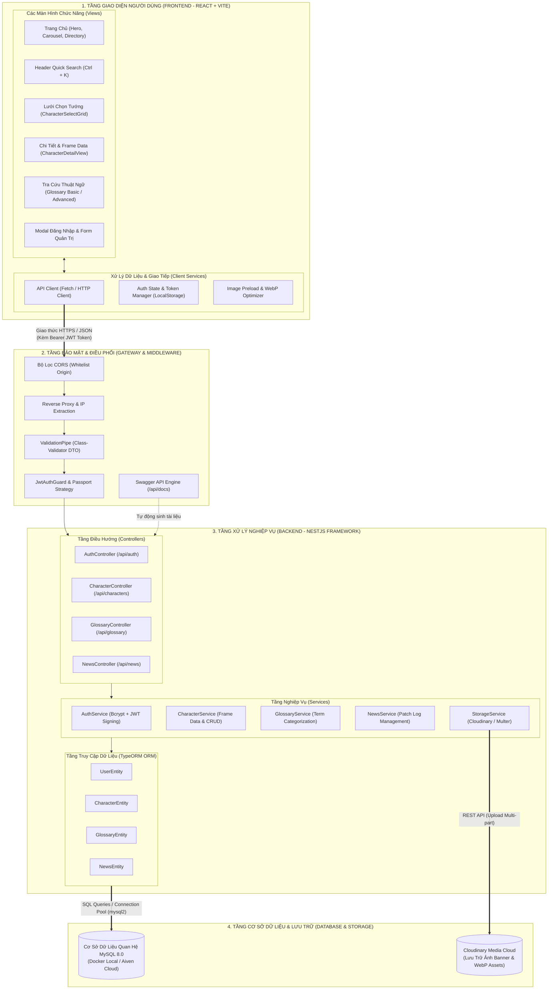

# Idol Showdown Wiki - Hệ Thống Tra Cứu Frame Data & Glossary


> Xây dựng ứng dụng web tra cứu Frame Data và Thuật ngữ (Glossary) dành cho người mới chơi và tuyển thủ tựa game đối kháng **Idol Showdown**.

---

## 🛠️ Công Cụ & Framework Sử Dụng

### 1. Frontend (Giao diện người dùng)
- **Framework / Core:** [React 19](https://react.dev/) + [TypeScript](https://www.typescriptlang.org/) / JSX
- **Build Tool / Bundler:** [Vite 6+](https://vitejs.dev/) - Hot Module Replacement (HMR) cực nhanh
- **Styling:** CSS3 thuần với Responsive Design, CSS Grid, Flexbox, hỗ trợ [Tailwind CSS v4](https://tailwindcss.com/)
- **Định dạng & Tối ưu Media:** Định dạng ảnh thế hệ mới `.webp` kết hợp thuật toán tiền tải dữ liệu (`preloadCharacterAssets`), giảm tải dung lượng tới 90% (từ 16MB xuống ~1MB)
- **Font & Icon:** Pixelify Sans, Podkova, SF Compact Rounded

### 2. Backend (Máy chủ API & Nghiệp vụ)
- **Framework:** [NestJS 10](https://nestjs.com/) (Mô hình phân lớp Module, Controller, Service, Repository theo chuẩn Enterprise) kết hợp [Express](https://expressjs.com/)
- **Ngôn ngữ:** TypeScript & Node.js (v20+)
- **ORM (Object-Relational Mapping):** [TypeORM](https://typeorm.io/) - Ánh xạ thực thể CSDL quan hệ, hỗ trợ Repository Pattern, Migration và chống SQL Injection
- **API Documentation:** [Swagger / OpenAPI 3.0](https://swagger.io/) (`@nestjs/swagger`) được cấu hình tự động tại `/api/docs`

### 3. Cơ Sở Dữ Liệu & Lưu Trữ (Database & Storage)
- **Database Chính:** [MySQL 8.0](https://www.mysql.com/) (Hỗ trợ chạy môi trường Docker cục bộ hoặc Cloud Database trên [Aiven](https://aiven.io/))
- **Kết nối CSDL:** Driver `mysql2` với cấu hình Connection Pool
- **Lưu trữ Media Đa Phương Tiện:** [Cloudinary API](https://cloudinary.com/) & Lưu trữ cục bộ qua Multer (`uploads/`)

### 4. An Toàn & Bảo Mật (Security)
- **Xác thực & Định danh:** [JWT (JSON Web Token)](https://jwt.io/) với `@nestjs/jwt` & `passport-jwt`
- **Mã hóa mật khẩu:** [Bcrypt.js](https://github.com/dcodeIO/bcrypt.js) với cơ chế Salt Rounds = 10 (bất khả đảo)
- **Chính sách CORS:** Whitelist dynamic domain (`localhost:3000`, `localhost:5000`, Render Domain)
- **Lọc & Kiểm định dữ liệu:** `ValidationPipe` kết hợp `class-validator` & `class-transformer` (loại bỏ thuộc tính lạ chống Mass Assignment)
- **Bảo vệ Proxy:** Cấu hình Reverse Proxy Trust (`X-Forwarded-For`) hỗ trợ môi trường Cloud/Render

### 5. Quản Lý Mã Nguồn & Triển Khai (DevOps & Testing)
- **Quản lý mã nguồn:** Git & GitHub với các nhánh chuẩn (`main`, `beta`, `exp`)
- **Container hóa:** Docker & Docker Compose (`docker-compose.yml`, Dev Container)
- **Kiểm thử (Testing):** [Jest](https://jestjs.io/) & `ts-jest` cấu hình trong `jest.config.js`

---

## 🏛️ Kiến Trúc Hệ Thống (System Architecture)

Dự án áp dụng mô hình kiến trúc **Phân lớp Đa tầng (Multi-Tier Layered Architecture)** với tính độc lập cao giữa Frontend và Backend (Decoupled), đảm bảo các nguyên lý thiết kế phần mềm hiện đại như **Separation of Concerns (SoC)** và **Dependency Injection (DI)**:



### Chi Tiết Về 4 Phân Tầng:
1. **Tầng 1: Presentation Tier (Giao diện người dùng - React 19 + Vite):**
   - Đảm nhận toàn bộ hiển thị giao diện Single Page Application (SPA), rendering component dạng bảng kỹ thuật Frame Data phân màu theo lợi thế đòn đánh.
   - Quản trị trạng thái cục bộ, lưu trữ JWT Token an toàn và áp dụng cơ chế Preload Assets giúp chuyển trang dưới 50ms.
2. **Tầng 2: Security & Gateway Tier (Lớp Bảo vệ & Điều phối):**
   - Đóng vai trò là bức tường lửa (Firewall): Kiểm tra Whitelist tên miền thông qua CORS, bóc tách IP qua Proxy Trust và lọc sạch tham số rác với `ValidationPipe`.
   - Bảo vệ nghiêm ngặt các route quản trị CMS thông qua `JwtAuthGuard`.
3. **Tầng 3: Business Logic Tier (Tầng Nghiệp vụ - NestJS 10):**
   - **Controllers:** Định tuyến tiếp nhận yêu cầu RESTful API và xuất schema Swagger.
   - **Services:** Chứa 100% logic nghiệp vụ (mã hóa mật khẩu Bcrypt, xử lý framedata, phân loại thuật ngữ).
   - **TypeORM Repositories:** Ánh xạ dữ liệu hướng đối tượng và thực thi truy vấn tham số hóa (Parameterized Queries) ngăn chặn 100% lỗi SQL Injection.
4. **Tầng 4: Data & Storage Tier (Tầng Dữ liệu & Lưu trữ):**
   - **MySQL 8.0:** Lưu trữ dữ liệu quan hệ (Nhân vật, Frame Data chiêu thức, Thuật ngữ, Quản trị viên).
   - **Cloudinary / Static Storage:** Lưu trữ và phân phối tài nguyên ảnh đa phương tiện dung lượng cao.

---

## 📂 Cấu Trúc Thư Mục Dự Án (Project Layout)

```text
web-app/
├── server/                    # Source code Backend NestJS
│   └── src/
│       ├── entities/          # Các thực thể CSDL TypeORM (Character, Glossary, News, User)
│       ├── modules/           # Phân hệ nghiệp vụ (auth, character, glossary, news, security, storage)
│       ├── app.module.ts      # Root Module kết nối TypeORM và cấu hình ứng dụng
│       └── main.ts            # Điểm khởi chạy NestJS, cấu hình CORS, ValidationPipe, Swagger
├── src/                       # Source code Frontend React
│   ├── assets/                # Hình ảnh, sprite, banner nhân vật (.webp, .png)
│   ├── components/            # Các UI Component (CharacterSelectGrid, CharacterDetailView, Glossary, Footer,...)
│   ├── data/                  # Dữ liệu tĩnh khởi tạo (glossaryData, newsData)
│   ├── utils/                 # Utility functions (characterAssets, decodeImage)
│   ├── App.jsx / App.css      # Component chính và định nghĩa bố cục toàn diện
│   └── main.tsx               # Điểm gắn kết React DOM
├── database/                  # Schema CSDL và migration scripts
├── docs/                      # Tài liệu kiến trúc, CSDL và hướng dẫn triển khai
├── uploads/                   # Thư mục lưu trữ media động (chạy runtime)
├── docker-compose.yml         # Thiết lập container MySQL cho môi trường cục bộ
├── package.json               # Danh sách thư viện và scripts vận hành
└── tsconfig.server.json       # Cấu hình biên dịch TypeScript cho NestJS backend
```

---

## 🚀 Hướng Dẫn Cài Đặt & Chạy Môi Trường Cục Bộ (Localhost)

### Yêu Cầu Tiên Quyết
- **Node.js**: Phiên bản `v20.x` trở lên ([Tải tại đây](https://nodejs.org/))
- **Docker Desktop** (Nếu muốn chạy MySQL qua container) hoặc cài đặt sẵn **MySQL Server 8.0**
- **Git**

---

### Bước 1: Sao chép mã nguồn (Clone Repository)

```bash
git clone https://github.com/nhom2-web-avd/Xay-dung-ung-dung-tra-cuu-Framedate-va-Glossary-cho-nguoi-moi.git
cd Xay-dung-ung-dung-tra-cuu-Framedate-va-Glossary-cho-nguoi-moi
```

---

### Bước 2: Cài đặt Dependencies

Cài đặt tất cả các gói phụ thuộc cho cả Frontend và Backend:

```bash
npm install
```

---

### Bước 3: Cấu hình biến môi trường (`.env`)

Tạo tệp `.env` tại thư mục gốc của dự án (sao chép từ `.env.example` nếu có):

```env
# Cấu hình Server
PORT=5000
HOST=127.0.0.1
NODE_ENV=development
APP_URL=http://localhost:3000

# Cấu hình Kết nối CSDL MySQL (Mặc định khi dùng Docker)
DB_HOST=127.0.0.1
DB_PORT=3306
DB_USER=root
DB_PASSWORD=rootpassword
DB_NAME=idol_showdown

# Cấu hình Bảo mật JWT
JWT_SECRET=super_secret_jwt_key_idol_showdown_2026
JWT_EXPIRES_IN=7d

# Cấu hình Admin Khởi tạo Mặc định
ADMIN_DEFAULT_USERNAME=admin
ADMIN_DEFAULT_PASSWORD=admin123
```

---

### Bước 4: Khởi động Cơ Sở Dữ Liệu MySQL

#### Cách A: Sử dụng Docker (Khuyên dùng)
Chạy MySQL 8.0 thông qua Docker Compose chỉ với một câu lệnh:

```bash
npm run db:up
```
*(Để kiểm tra log CSDL: `npm run db:logs` | Để dừng CSDL: `npm run db:down`)*

#### Cách B: Sử dụng MySQL Server cài trực tiếp trên máy
Đảm bảo dịch vụ MySQL đang chạy trên cổng `3306` và thông tin tài khoản khớp với file `.env`.

Sau khi CSDL sẵn sàng, tiến hành khởi tạo bảng và dữ liệu mẫu:

```bash
npm run db:migrate
```

---

### Bước 5: Khởi Chạy Ứng Dụng (Development Mode)

Chạy đồng thời cả **Client (React)** và **Server (NestJS API)** bằng một lệnh duy nhất:

```bash
npm run dev
```

Hoặc bạn có thể mở 2 cửa sổ Terminal để chạy độc lập:

- **Terminal 1 - Khởi chạy Backend:**
  ```bash
  npm run dev:server
  ```
- **Terminal 2 - Khởi chạy Frontend:**
  ```bash
  npm run dev:client
  ```

---

### 🌐 Các Cổng Truy Cập Hệ Thống

| Dịch vụ | Đường dẫn truy cập | Mô tả |
| :--- | :--- | :--- |
| **Frontend UI** | [http://localhost:3000](http://localhost:3000) | Giao diện tra cứu Frame Data & Glossary |
| **Backend API** | [http://localhost:5000](http://localhost:5000) | Cổng tiếp nhận RESTful API |
| **Swagger API Docs** | [http://localhost:5000/api/docs](http://localhost:5000/api/docs) | Tài liệu tra cứu và thử nghiệm API trực quan |
| **Health Check DB** | [http://localhost:5000/health/db](http://localhost:5000/health/db) | Kiểm tra trạng thái kết nối MySQL |

---

## 🛠️ Các Lệnh Thường Dùng (NPM Scripts)

```bash
# Biên dịch đóng gói toàn bộ dự án cho Production
npm run build

# Chạy kiểm thử Unit Test với Jest
npm run test

# Khởi chạy ứng dụng production
npm start
```

---

## 📜 Giấy Phép & Bản Quyền (License & Disclaimer)

- Dự án được phát hành và quản lý mã nguồn mở dưới giấy phép **[MIT License](LICENSE)**.
- **Tuyên Bố Bản Quyền (Disclaimer):**  
  Tựa game *Idol Showdown* thuộc quyền sở hữu trí tuệ của **Besto Game Team**. Hình ảnh nhân vật, tên gọi và thương hiệu liên quan thuộc bản quyền của **COVER Corporation** / **hololive production**. Dự án này được thực hiện phi thương mại bởi sinh viên với mục đích nghiên cứu học thuật và xây dựng cẩm nang tra cứu hỗ trợ cộng đồng người chơi.
